# LaunchIQ demo

A 6-minute walkthrough you can run yourself, with the exact inputs and what you should see.

> **Read this first.** There is no hosted demo yet. The demo runs on your own computer with a **fake model**
> (`LLM_PROVIDER=fake`), so it needs no API keys, and the text it generates is placeholder content
> (for example "$4.2B globally (fake data)"). What it demonstrates is the product flow: progress, human review,
> editing, results, export and analytics. Real research and writing need an `ANTHROPIC_API_KEY`
> (set `LLM_PROVIDER=anthropic`); no live run has been recorded yet, so real run times and quality are unmeasured.

## 1. Run it

Needs Python 3.12+, Node 22+, pnpm and `redis-server`.

```bash
git clone https://github.com/VenkataAnilKumar/LaunchIQ && cd LaunchIQ
pip install -r src/apps/api/requirements.txt
make local                                                   # API on :8000 (fake model, SQLite, local Redis)
source scripts/local_env.sh && python3 src/data/seed.py --demo --user-id local-dev-user   # optional: a finished sample launch
cd src/apps/web && pnpm install
NEXT_PUBLIC_DEV_BEARER_TOKEN=$(python3 ../../../scripts/dev_token.py) pnpm dev            # web on :3000
```

Open http://localhost:3000. Stop with `make local-down`.

## 2. The walkthrough

| # | Do this | You should see |
|---|---------|----------------|
| 1 | Open the landing page and click **Try a sample brief**. | A short explanation of the product and the form pre-filled with the sample below. 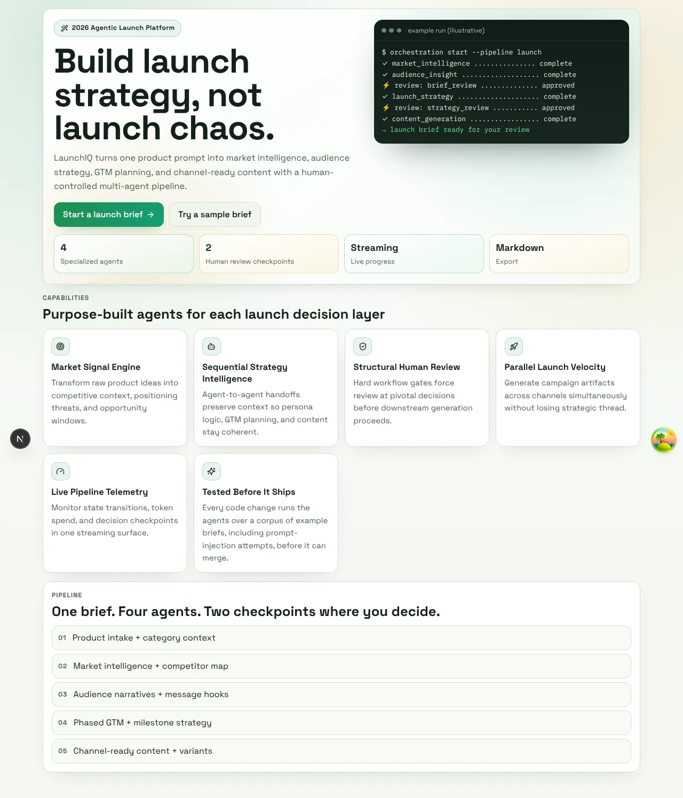 |
| 2 | On **New launch**, check the form (or click the **B2B SaaS** chip), then **Create launch**. | Inputs below; an empty form shows inline errors instead. 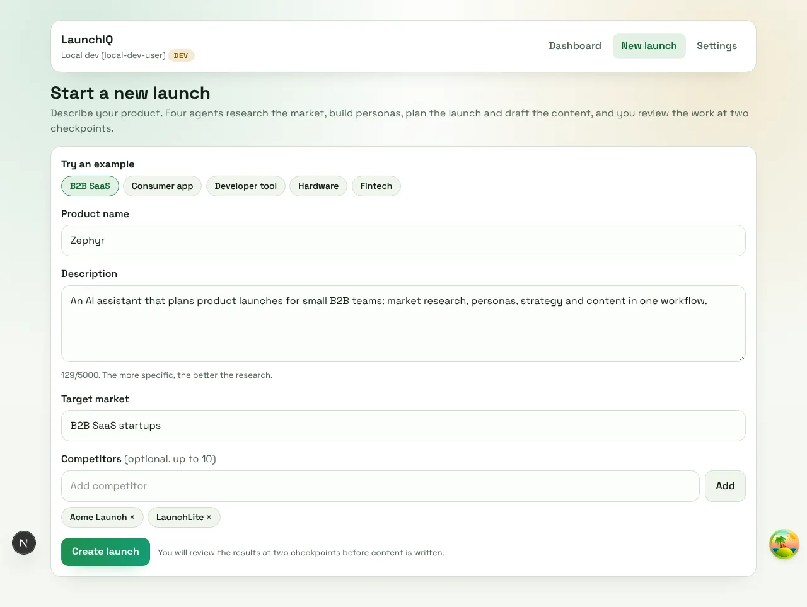 |
| 3 | Watch the **Progress** page. | Four steps (Market Intelligence, Audience Insight, Launch Strategy, Content Generation), a live "connected" indicator and a running cost estimate. The pipeline stops at the first checkpoint. |
| 4 | **Review 1 (market research).** Type the comment `Looks right`, click **Approve**. | The research is shown formatted (market size, competitors, white space), not as raw data. You can click the **Market** tab to read it while the pipeline waits. 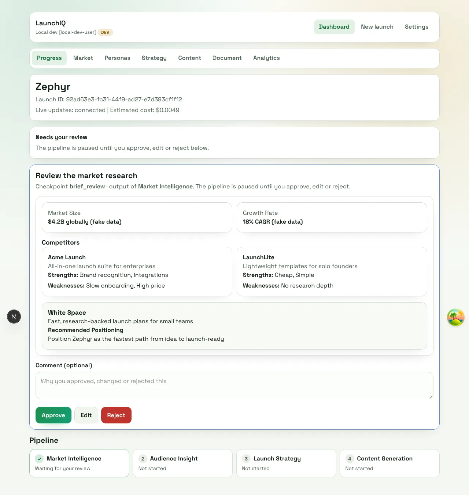 |
| 5 | **Review 2 (launch strategy).** Click **Edit**. | A form generated from the agent's own schema. 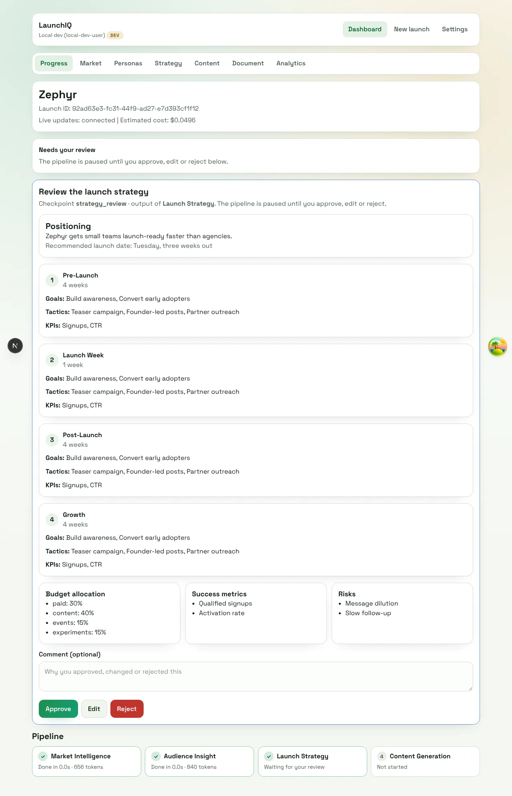 |
| 6 | Change **Positioning Statement** to `Zephyr gets small B2B teams launch-ready in an afternoon, not a quarter.` and click **Submit edits**. | Later steps use your edited version. Clearing a required field keeps the form open and explains what is wrong; **Esc** cancels. 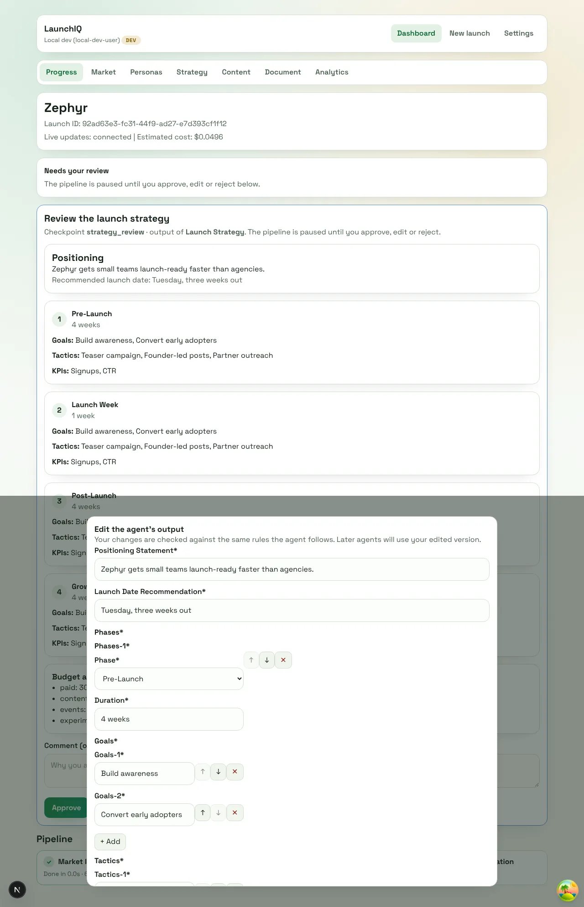 |
| 7 | When the status shows **Completed**, open the tabs **Market**, **Personas**, **Strategy**, **Content**. | The four sections; content has email, social and ad variants A/B with copy buttons. 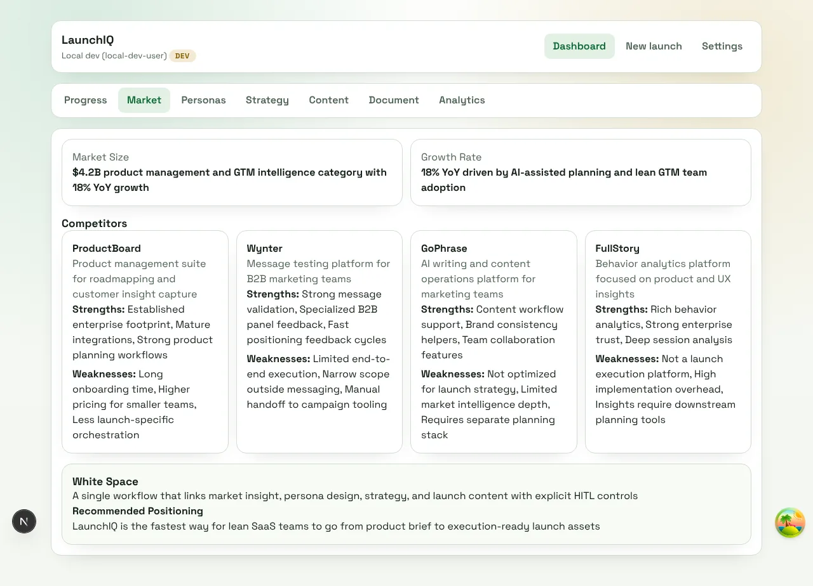 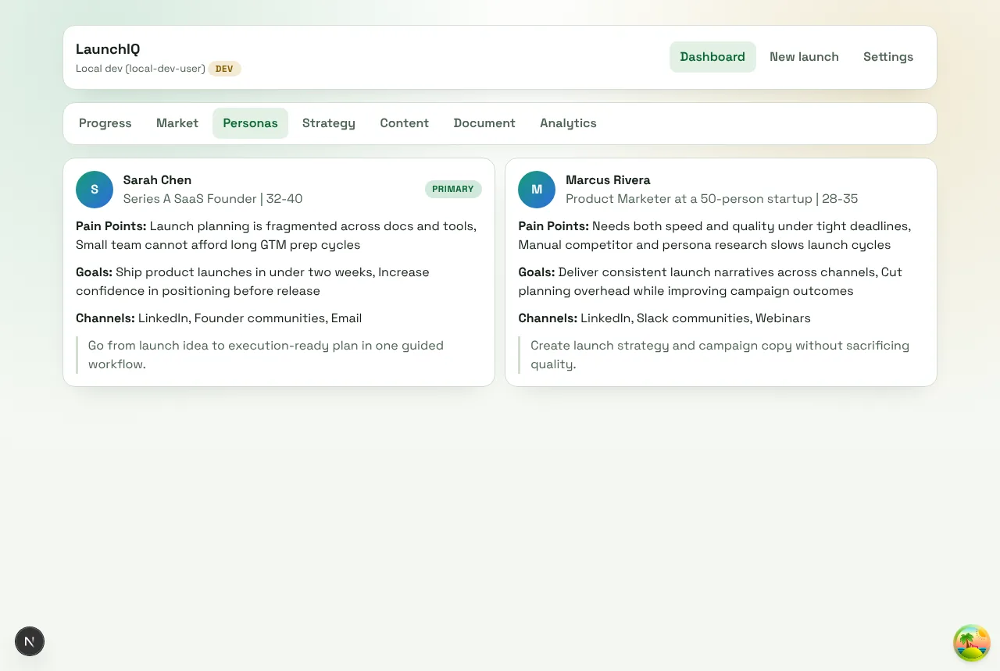 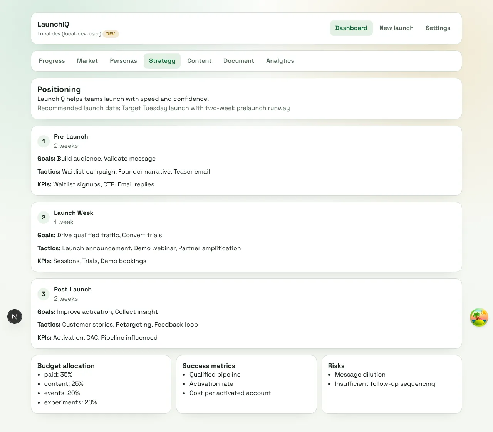 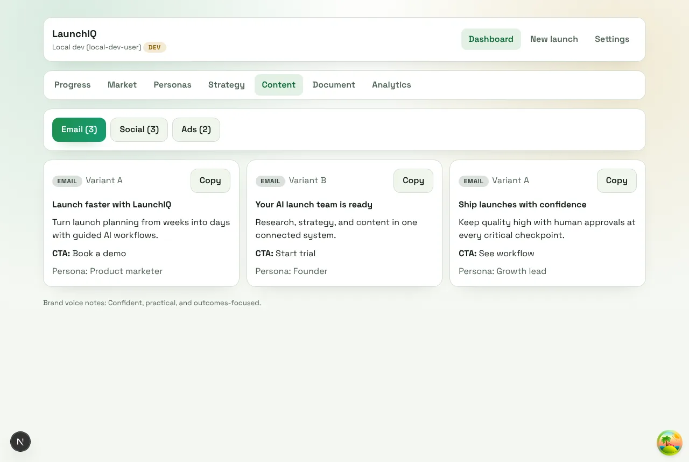 |
| 8 | Open **Document**, then **Download .md**. | The whole launch as one rendered document, including your edit; the file is `zephyr-brief.md`. 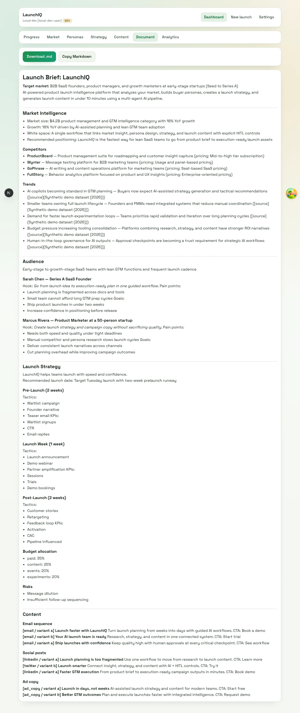 |
| 9 | Open **Analytics**, paste the metrics below, click **Analyze results**. | Recommendations based only on those numbers, with priorities. 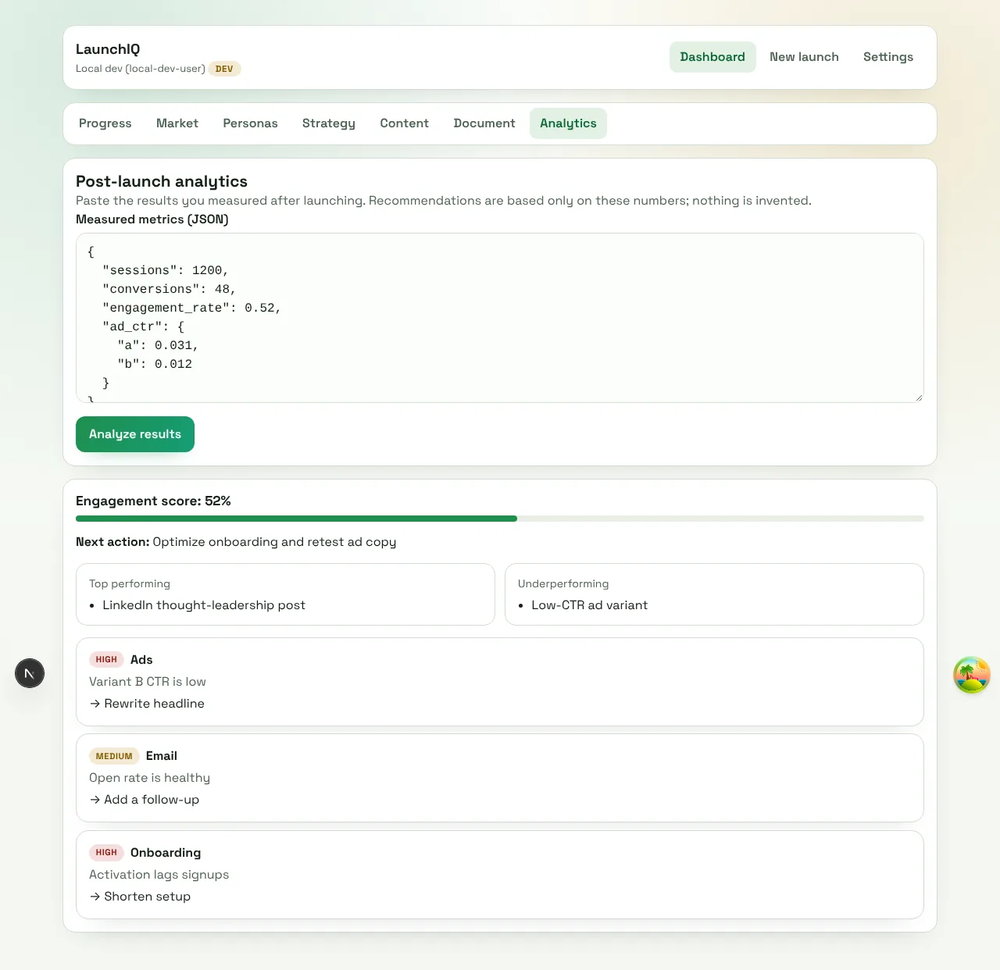 |
| 10 | Go to **Dashboard**. | Counts, search, status filters, and a highlight on launches that need review. 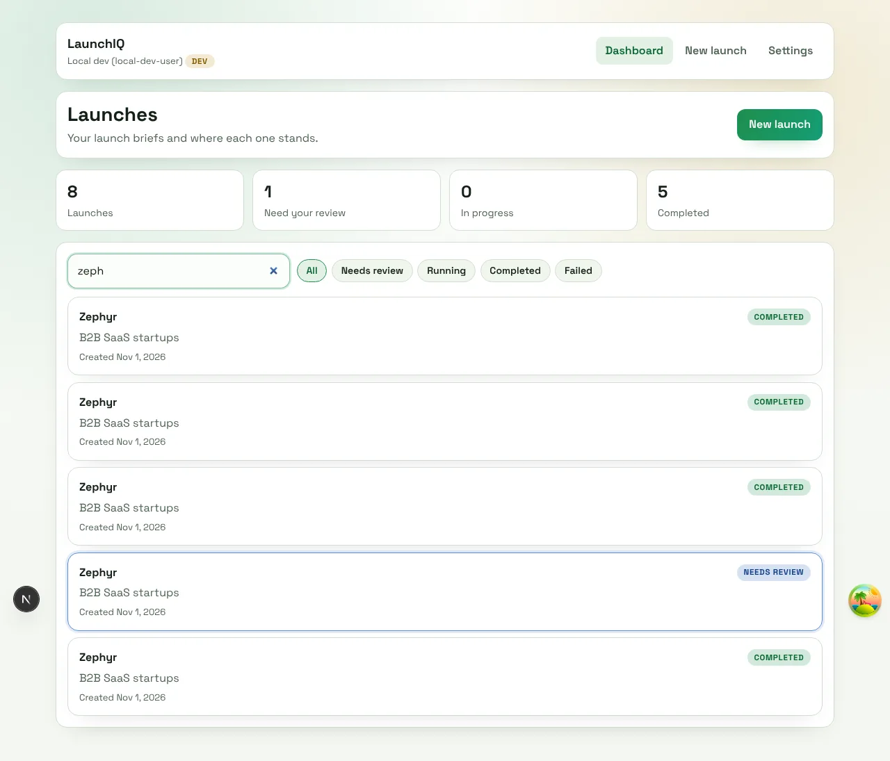 |

### Exact inputs

**Sample brief ("B2B SaaS" chip, `/launch/new?sample=0`)**

| Field | Value |
|-------|-------|
| Product name | `Zephyr` |
| Description | `An AI assistant that plans product launches for small B2B teams: market research, personas, strategy and content in one workflow.` |
| Target market | `B2B SaaS startups` |
| Competitors | `Acme Launch`, `LaunchLite` |

Four more samples are one click away: Consumer app (Tempo), Developer tool (ShipMate CLI), Hardware (Lumo), Fintech (Ledgerly).

**Analytics metrics (the form is pre-filled with these)**

```json
{ "sessions": 1200, "conversions": 48, "engagement_rate": 0.52, "ad_ctr": { "a": 0.031, "b": 0.012 } }
```

### Skip the wait: the finished sample launch

`python3 src/data/seed.py --demo --user-id local-dev-user` adds a completed launch for LaunchIQ itself, with
hand-written market, persona, strategy and content data. Open it from the dashboard to show every results page immediately.

## 3. Also worth showing

- **Reject** at a checkpoint: the pipeline stops, the status becomes **Rejected**, and the dashboard shows it.
- **Phone layout** (resize the browser to about 390px wide): 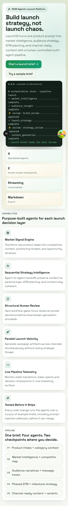 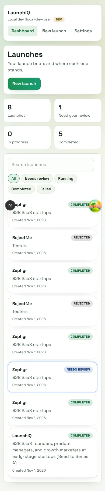
- **A failure**: start the API without a model key (`LLM_PROVIDER=anthropic ANTHROPIC_API_KEY= scripts/local_stack.sh up inline`)
  and create a launch. The page shows the real cause and a **Retry** button. 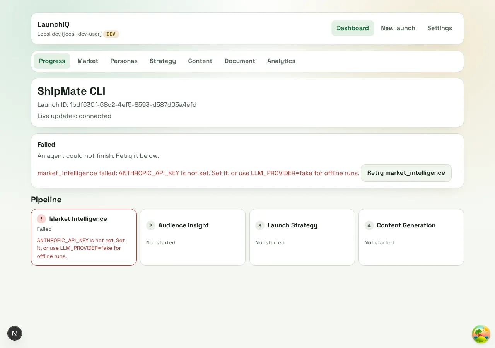

## 4. Replay the whole demo automatically

```bash
node scripts/e2e/browser_flow.js      # steps 1-10 above, with assertions; screenshots go to .local/shots/
node scripts/e2e/browser_reject.js    # the reject path
node scripts/e2e/browser_edge.js      # keyboard, validation and error screens
```

These need Playwright and Chromium and a running stack (`make local` plus `pnpm dev`).

## 5. What the demo does not show

Real model output, real web research, a hosted URL, real sign-in (Clerk), billing, and the HubSpot, Slack and GA4
integrations (the Settings page marks them as a preview). See the **Project Status** section of the main README.
